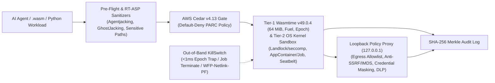

<p align="center">
  
</p>

<h1 align="center">AgentOctopus</h1>

<p align="center">
  <strong>Single-Binary Rust Deterministic Agent Containment Runtime</strong><br />
  AWS Cedar v4.13 &bull; Wasmtime v49.0.4 &bull; OS Kernel Sandboxes &bull; RT-ASP Sanitizers
</p>

<p align="center">
  <a href="https://crates.io/crates/agent_octopus"></a>
  <a href="LICENSE-MIT"></a>
  <a href="LICENSE-APACHE"></a>
  <a href="https://www.cedarpolicy.com/"></a>
  <a href="https://wasmtime.dev/"></a>
  <a href="docs/AGENTMESH_WASM_INTEGRATION.md"></a>
</p>

> **`google/agentmesh` connects agents across machines; AgentOctopus is the single-binary Rust runtime that makes sure a hijacked agent can't own the machine or exfiltrate secrets—100x lighter and faster than Python governance gateways (such as CAGE).**

Every allow/deny decision in AgentOctopus is enforced **100% deterministically** at the host and process boundary by **RT-ASP Sanitizers**, **AWS Cedar v4.13**, **Wasmtime v49.0.4**, and **native OS kernel sandboxes** paired with a loopback egress and credential-masking proxy.

---

## The 4 Deterministic Containment Pillars

| Pillar | Mechanism | What It Stops Deterministically |
|---|---|---|
| **1. RT-ASP Sanitizers** | Agentjacking/GhostJacking Unicode stripping, EchoLeak Markdown image defanging, taint-to-sink DAG checks, sensitive-path & mandatory write-deny guards (`.ssh`, `.aws`, `.git/hooks`, `.mcp.json`), `SemanticDlpEngine` | Prompt/context smuggling, secret leakage in payloads, unauthorized sensitive file/hook writes ([`src/security/rasp/`](src/security/rasp/), [`src/security/sensitive_paths.rs`](src/security/sensitive_paths.rs)) |
| **2. AWS Cedar v4.13 Gate** | Default-deny PARC policy evaluation (`cedar-policy` `v4.13.0`) over `Octopus::Command`, `Octopus::NetworkTarget`, and `Octopus::FilePath` with cryptographic audit control tokens | Unauthorized tool/command execution, unapproved outbound hosts, unauthorized filesystem reads/writes ([`src/security/cedar_arm/`](src/security/cedar_arm/)) |
| **3. Wasmtime v49.0.4 Tier-1 Sandbox** | Zero ambient WASI sockets/FS/env, `64 MiB` max linear memory (`ResourceLimiter`), deterministic Cranelift fuel metering, `<1ms` epoch KillSwitch trap | Arbitrary host syscalls, memory exhaustion, infinite loops, guest secret inspection ([`src/security/wasm_tier1.rs`](src/security/wasm_tier1.rs)) |
| **4. OS Kernel Sandbox + Loopback Policy Proxy** | Linux Landlock LSM + 18-syscall `seccomp-BPF` + `PR_SET_NO_NEW_PRIVS` + `RLIMIT_AS`; Windows Job Object + de-elevated restricted token (`standard`) or AppContainer (`strict`); macOS Seatbelt SBPL + `libproc`; ephemeral `127.0.0.1` HTTP/CONNECT proxy with DNS-pinning/IMDS block & `CredentialSentinelMasker` (`ao_mask_*`) | Cloud IMDS (`169.254.169.254`), DNS rebinding, raw IP/hex/userinfo SSRF, child process breakaway, plaintext API key exfiltration ([`src/cli/proxy.rs`](src/cli/proxy.rs), [`src/cli/run.rs`](src/cli/run.rs)) |

---

## 30-Second 1-Command CLI Quickstart

Build the single-binary `octopus` CLI and run the zero-dependency Python stdlib quickstart ([`examples/quickstart/policy.json`](examples/quickstart/policy.json), [`examples/quickstart/policy.cedar`](examples/quickstart/policy.cedar), [`examples/quickstart/my_agent.py`](examples/quickstart/my_agent.py)):

```bash
# Build the single-binary CLI
cargo build --release --bin octopus

# 1. Run under JSON policy (permits workspace read, blocks Cloud IMDS & unapproved egress)
octopus run --policy examples/quickstart/policy.json -- python examples/quickstart/my_agent.py

# 2. Or enforce an AWS Cedar v4.13 policy directly
octopus run --policy examples/quickstart/policy.cedar -- python examples/quickstart/my_agent.py
```

Verified output from running `octopus run --policy examples/quickstart/policy.json -- python examples/quickstart/my_agent.py`:

```text
[octopus] DENY egress GET http://169.254.169.254/latest/meta-data/iam/security-credentials/ -> HTTP 403 (cloud_metadata_ip_blocked: '169.254.169.254')
[octopus] DENY egress GET http://evil.example.com/exfil -> HTTP 403 (target 'evil.example.com:80' matched denied_domains rule 'evil.example.com')
[ALLOW] Policy-permitted Python execution & policy.json read: OK (allowed_domains=['api.github.com'])
[BLOCKED] Cloud IMDS 169.254.169.254 -> HTTP 403 (blocked_by_octopus_policy)
[BLOCKED] Unapproved domain evil.example.com -> HTTP 403 (blocked_by_octopus_policy)
```

### Sandbox Modes (`--sandbox standard` vs `--sandbox strict`), `.wasm` Guests & JSON Output

```bash
# Machine-readable JSON verdict & egress audit log
octopus run --policy examples/quickstart/policy.json --json -- python examples/quickstart/my_agent.py

# Execute an untrusted .wasm or .wat module directly inside Wasmtime v49.0.4
octopus run --policy examples/quickstart/policy.json -- my_tool.wat

# Strict OS kernel confinement
octopus run --policy examples/quickstart/policy.json --sandbox strict -- python examples/quickstart/my_agent.py
```

- **`--sandbox standard` (default)**:
  - **Windows**: Runs with a de-elevated restricted token + `WindowsJobObject` (`ActiveProcessLimit`, `ProcessMemoryLimit`) + loopback policy proxy (`windows-deelevated+job`), working cleanly across standard Python installations (e.g. Python 3.13 & 3.14).
  - **Linux**: Applies `PR_SET_NO_NEW_PRIVS`, Landlock LSM path rules, and `RLIMIT_AS` / `RLIMIT_NOFILE` / `RLIMIT_CORE=0` resource clamps.
  - **macOS**: Enforces a fail-closed Seatbelt SBPL profile (`(version 1) (deny default)`) and `libproc` descendant freezing.
- **`--sandbox strict`**:
  - **Windows (`windows-appcontainer+job`)**: Creates an ephemeral Windows AppContainer (`S-1-15-2-...`) + `WindowsJobObject` + Named Pipe Cedar FS IPC (`\\.\pipe\octopus-cedar-...` with per-SID SDDL DACL). **Host ACL requirement**: the target executable/interpreter directory must grant `ALL APPLICATION PACKAGES` (`S-1-15-2-1`) `(RX)` ACLs (e.g. Python 3.14 passes while an un-ACL'd Python 3.13 directory fails closed with `0xC0000135`), and unprivileged processes without loopback exemption run with `CapabilityCount = 0` so unapproved socket operations fail fast.
  - **Linux**: Installs the 18-syscall `seccomp-BPF` socket filter (`EACCES`) when no allowed domains or Cedar IPC sockets are declared and fails closed if Landlock/`seccomp-BPF` cannot be applied.
  - **macOS**: Enforces strict Seatbelt confinement without fallback when kernel sandbox initialization fails.

### CLI Synopsis & Exit Codes

```text
octopus run --policy <PATH> [--sandbox <strict|standard|wasm-strict>] [--wasm-promote] [--timeout <SECS>] [--cwd <DIR>] [--baseline-sbom <PATH> --sbom <PATH>] [--sbom-intent <patch|minor|refactor>] [--latent-weights <PATH>] [--json] -- <COMMAND> [ARGS...]
```

| Flag / Exit Code | Meaning |
|---|---|
| `--policy <PATH>` | Required `.json` or `.cedar` policy file (wildcards like `*` in `allowed_domains` fail closed). |
| `--sandbox <strict\|standard\|wasm-strict>` | OS or Wasm-enforced confinement profile (default: `standard`; `wasm-strict` + `--wasm-promote` enforce `.wasm`/`.wat` guests when the R6 Virtual-Patch Shield is active). |
| `--timeout <SECS>` | Wall-clock execution limit (`0` disables; defaults to policy `limits.timeout_secs` or `60`). |
| `--cwd <DIR>` | Working directory for the contained child process. |
| `--baseline-sbom`, `--sbom`, `--sbom-intent`, `--latent-weights` | R8 Gate 1 pre-Wasmtime / pre-spawn CycloneDX SBOM supply-chain check (`patch\|minor\|refactor`) with embedded or custom `UnifiedSecurityShield` JSON weights. |
| `--json` | Emit single-line `JsonRunSummary` (`status`, `sandbox`, `backend`, `egress_events`, `virtual_patch_shield`, `sbom_guard`, `runtime_guard`). |
| Exit `0` (or child code) | Policy-permitted execution completed. |
| Exit `1` | Sandbox or runtime enforcement failure. |
| Exit `2` | Pre-flight fail-closed denial (missing/invalid policy, missing `--`, R7 REA binary gate, R8 SBOM gate, Cedar `exec`, or RT-ASP gate). |
| Exit `124` | Deterministic timeout / KillSwitch epoch termination. |

Full CLI & policy reference: [`docs/CLI_AND_POLICY_REFERENCE.md`](docs/CLI_AND_POLICY_REFERENCE.md).

---

## Control Plane vs. Containment Boundary (`google/agentmesh` & CAGE Contrast)

### Complementing `google/agentmesh`

`google/agentmesh` provides the multi-node control and mesh plane (SPIFFE workload identity, Biscuit Datalog task authority, `libp2p` transport), while **AgentOctopus** provides the host/process containment runtime:

- **[`google/agentmesh#887`](https://github.com/google/agentmesh/pull/887) (merged)**: Capability-isolated Wasmtime guests (`64 MiB` cap, zero ambient WASI sockets/FS/env) paired with an out-of-sandbox host PEP handling `ES256` OIDC/JWKS workload identity and RFC 8693/7009 Biscuit token exchange.
- **[`google/agentmesh#897`](https://github.com/google/agentmesh/pull/897) (out-of-band `SecuritySignalEvent`)**: CloudEvents 1.0 containment webhook contract over `unix:`, `https://` mTLS, or `127.0.0.1` allowing host runtimes to freeze, kill, or evict compromised agents out-of-band.

Run the live multi-node `google/agentmesh v0.2.0` integration end-to-end:

```bash
# Linux / macOS
./examples/agentmesh-wasm-sandbox/run.sh

# Windows PowerShell
powershell -ExecutionPolicy Bypass -File examples\agentmesh-wasm-sandbox\run.ps1
```

Full topology, wire traces, and 8-case verification matrix: [`docs/AGENTMESH_WASM_INTEGRATION.md`](docs/AGENTMESH_WASM_INTEGRATION.md).

### Why AgentOctopus Instead of Heavy Python Governance Gateways (CAGE)

| Dimension | Python Governance Gateways (e.g., CAGE / `cybernetic-agent-governance-engine`) | AgentOctopus (Single-Binary Rust Runtime) |
|---|---|---|
| **Deployment Footprint** | Multi-service Python ASGI/FastMCP stack + Redis + Linkerd mTLS + KMS + OPA sidecars | **1 static Rust binary** (`octopus`) — zero external daemons, zero Docker/Redis required |
| **Enforcement Boundary** | Out-of-process HTTP/MCP proxy checks | **In-process & kernel boundary**: Wasmtime v49.0.4, Landlock + `seccomp-BPF`, Windows AppContainer + Job Object, macOS Seatbelt + loopback proxy |
| **Secret Isolation** | Tokens/keys live in Python process memory and proxy middleware | `CredentialSentinelMasker` keeps raw secrets out of child env (`ao_mask_*`) and out of Wasm linear memory (`0` JWT/Biscuit bytes) |
| **Kill & Teardown** | HTTP 503 / async gateway revocation | `<1ms` Wasmtime `increment_epoch()`, `TerminateJobObject`, `libproc` `SIGKILL` subtree freeze, native WFP/Netlink/`/dev/pf` KillSwitch |
| **Wire Compatibility** | Native CAGE `RoutingSeal` | Optional Rust `CageGovernanceEngine` ([`src/security/cage_governance/`](src/security/cage_governance/)) for `RoutingSeal` parity without Python/Redis overhead |

---

## Deterministic Architecture

Every action traverses a strictly deterministic enforcement pipeline before reaching the OS or network, monitored by an out-of-band KillSwitch and recorded in an append-only SHA-256 Merkle audit log:



---

## Documentation Index

| Guide / Artifact | Focus |
|---|---|
| **[Documentation Hub & A–Z Index](docs/README.md)** | Role-based reading paths, full Rust source module map, and A–Z topic/anchor index covering R1–R8 |
| **[Architecture & Security Model](docs/ARCHITECTURE_AND_SECURITY_MODEL.md)** | 4 Deterministic Pillars, R7 `<2ms` REA Binary Gate, R8 `UnifiedSecurityShield`, threat model |
| **[Kernel Patching & Zero-Breakout Shield](docs/KERNEL_PATCHING_AND_ZERO_BREAKOUT_SHIELD.md)** | R6 multi-OS kernel CVE/KEV patcher (6 OS families, 17 Linux distros), No Break-Out / No Break-In shields, 5 Foolproof Invariants |
| **[CLI & Policy Reference](docs/CLI_AND_POLICY_REFERENCE.md)** | All `octopus` subcommands, `run` flags, exit codes, `JsonRunSummary`, `OctopusRunPolicy`, 11-entity / 13-action Cedar schema |
| **[Operations & API Guide](docs/OPERATIONS_AND_API_GUIDE.md)** | `127.0.0.1:3030` Web Dashboard, `X-Octopus-Token` REST API, Host KillSwitch, signed builds, troubleshooting |
| **[AgentMesh x Wasm Integration](docs/AGENTMESH_WASM_INTEGRATION.md)** | `google/agentmesh v0.2.0` x `wasmtime v49.0.4` topology, OIDC/PEP bridge, 8 live E2E cases |
| **[Adversarial Defense & Red Teaming](docs/ADVERSARIAL_DEFENSE_AND_RED_TEAMING.md)** | Multi-arm enclave, `TarpitArm` honey-tokens, 19 red-teaming suites, 74-language determinism |
| **Examples & Reports** | [`examples/quickstart/`](examples/quickstart/policy.json), [`examples/agentmesh-wasm-sandbox/`](examples/agentmesh-wasm-sandbox/README.md), [`reports/vassilev_mathematical_validation.md`](reports/vassilev_mathematical_validation.md) |

---

## Pre-Spawn Binary, Supply-Chain, and Kernel Shields (R6–R8)

- **R6 — Universal Multi-OS Kernel Patcher & Zero-Reboot Shield** ([`docs/KERNEL_PATCHING_AND_ZERO_BREAKOUT_SHIELD.md`](docs/KERNEL_PATCHING_AND_ZERO_BREAKOUT_SHIELD.md)): Maps running kernels across **6 OS families** and **17 Linux distributions** to NIST NVD 2.0 + CISA KEV, delegates updates to vendor rebootless livepatch engines (`canonical-livepatch`, `kpatch`, `ksplice`, `klp`, Windows Hotpatch) and pinned OS patchers (`UsoClient`, `apt-get`, `dnf`, `zypper`, `pacman`, `apk`, `softwareupdate`, `freebsd-update`, `syspatch`, `sysupgrade`) without unsafe ring-0 splicing, and keeps `shield_locked_until_reboot` & `telemetry_degraded_fail_closed` active to guarantee a kernel bug never allows break-out or break-in.
- **R7 — `<2ms` Pure-Rust Pre-Spawn REA Binary Gate** ([`src/security/rea_binary_gate.rs`](src/security/rea_binary_gate.rs)): Inspects TOCTOU-locked PE/ELF/Mach-O/Wasm executable handles before child spawn (packers like UPX/VMP/Themida, `W^X` violations, entropy `>= 6.4` + anomaly, Authenticode/`LC_CODE_SIGNATURE`, Hell's/Halo's Gate & raw direct-syscall stubs) and feeds `ReaBinaryFact` into `ReteEngine` without heavy EDR disassembly bloat.
- **R8 — Pure-Rust `UnifiedSecurityShield`** ([`src/security/latent_shield.rs`](src/security/latent_shield.rs)): Pure-Rust (`ndarray` + `rand_distr`, zero Python/BLAS) shared `LatentWorldModel` with embedded deterministic weights (`latent_shield_weights.json`) guarding CycloneDX SBOM transitions pre-Wasmtime (`--baseline-sbom` / `--sbom` / `octopus sbom-guard`) and live runtime telemetry steps (`AgentRuntimeGuard`). Strictly **tighten-only** and completely distinct from the optional offline/advisory D3QN appendix below.

---

## Cross-Platform OS Enforcement & Host KillSwitch

AgentOctopus enforces native OS confinement and zero-subprocess network isolation across Linux, Windows, macOS, and BSD:

| Platform | Process & Filesystem Confinement | Out-of-Band Host KillSwitch (`src/security/host_network_isolation.rs`) |
|---|---|---|
| **Linux** | `PR_SET_NO_NEW_PRIVS`, Landlock LSM (read-only system/interpreter dirs + declared `allow_read`/`allow_write`), `seccomp-BPF` (sockets + R6 CVE EoP/escape syscalls + `clone3`), `RLIMIT_AS` / `RLIMIT_CPU` / `RLIMIT_NOFILE` / `RLIMIT_CORE=0`, optional `CLONE_NEWNET` | Netlink blackhole route / `SOCK_DESTROY` + `nftables` virtual-patch shield |
| **Windows** | `--sandbox standard`: de-elevated restricted token + `WindowsJobObject` (`ActiveProcessLimit`, `ProcessMemoryLimit`); `--sandbox strict`: ephemeral AppContainer (`S-1-15-2-...`) + Named Pipe Cedar FS IPC + `WindowsJobObject` + process mitigation mask + `\\.\OsoosiDriver` BYOVD blocklist | Windows Filtering Platform (WFP) 22/24-layer filters + BFE Registry enforcement (zero `netsh` subprocesses) |
| **macOS** | Seatbelt SBPL `(version 1) (deny default)` with `/var` -> `/private/var`, `/tmp` -> `/private/tmp` canonicalization, `system-kext-load`/`iokit-open` clamps + `libproc` (`proc_listchildpids`) fixed-point descendant freezing | `/dev/pf` binary `ioctl` anchor isolation + `/sbin/pfctl` virtual-patch shield |
| **BSD (`FreeBSD`, `OpenBSD`, `NetBSD`)** | OpenBSD `unveil()` + `pledge()`; FreeBSD `procctl(PROC_NO_NEW_PRIVS_CTL)` + Capsicum `cap_enter()`; NetBSD `setrlimit` | `/dev/pf` anchor isolation + native `freebsd-update` / `syspatch` / `sysupgrade` orchestration |

---

## Rust Crate Usage, Operational Subcommands & Web Dashboard (`127.0.0.1:3030`)

### Embedded Rust Policy Gate (`CedarPolicyEngine`)

```rust
use agent_octopus::security::cedar_arm::CedarPolicyEngine;
use serde_json::json;

fn main() -> Result<(), Box<dyn std::error::Error>> {
    let engine = CedarPolicyEngine::new()?;
    let verdict = engine.evaluate(
        "ledger_arm",
        "write",
        "Ledger",
        "Ledger",
        json!({
            "amount_cents": 50000,
            "approved": true
        }),
    )?;

    if verdict.is_allowed {
        println!("Allowed by Cedar: {:?}", verdict.determining_policies);
    } else {
        println!("Denied by Cedar: {:?}", verdict.diagnostic_errors);
    }
    Ok(())
}
```

### Operational CLI Subcommands & Web Dashboard (`http://127.0.0.1:3030`)

In addition to `octopus run`, the `octopus` binary exposes operational subcommands: `verify`, `status`, `protocols`, `hook`, `mcp-proxy`, `siquery`, `sbom-guard` (`latent-shield`), `kernel-patch` (`patch-kernel`), `isolate` (`engage`), `restore` (`disarm`), `killswitch`, `service`, and `start` (`serve`, `ui`). See [`docs/CLI_AND_POLICY_REFERENCE.md`](docs/CLI_AND_POLICY_REFERENCE.md) and [`docs/OPERATIONS_AND_API_GUIDE.md`](docs/OPERATIONS_AND_API_GUIDE.md).

To inspect live telemetry, Cedar policy evaluation, Merkle audit verification, and adversarial red-team suites in the Web Dashboard (bound to **`127.0.0.1:3030`**):

```bash
# Launch the Web Dashboard & API server on http://127.0.0.1:3030
cargo run --bin agent_octopus -- start --port 3030

# Or start headless/console mode
cargo run --bin start -- --console --port 3030
```

All `/api/*` endpoints require the operator token written to `logs/.octopus_operator_token` on startup:

```bash
TOKEN="$(cat logs/.octopus_operator_token)"

# Query deterministic engine & policy status
curl -H "X-Octopus-Token: ${TOKEN}" http://127.0.0.1:3030/api/status

# Evaluate an AWS Cedar v4.13 policy decision
curl -X POST http://127.0.0.1:3030/api/evaluate-cedar \
  -H "Content-Type: application/json" \
  -H "X-Octopus-Token: ${TOKEN}" \
  -d '{
    "principal": "ledger_arm",
    "action": "write",
    "resource": "Ledger",
    "context": { "amount_cents": 50000, "approved": true },
    "attach_supervisor_approval": true
  }'
```

For full multi-framework red-teaming suites (19 frameworks, 74-language determinism, and API schemas), see [`docs/ADVERSARIAL_DEFENSE_AND_RED_TEAMING.md`](docs/ADVERSARIAL_DEFENSE_AND_RED_TEAMING.md).

---

## Verification Suites

```bash
# Deterministic containment boundary & D3QN non-interference tests
cargo test --test deterministic_containment_boundary_tests

# 1-command CLI end-to-end containment tests
cargo test --test octopus_cli_e2e_tests

# AWS Cedar policy & AgentMesh integration suites
cargo test --test cedar_policy_tests
cargo test --test agentmesh_integration_tests

# R6 Kernel Shield, R7 <2ms REA Binary Gate & R8 UnifiedSecurityShield suites
cargo test --test virtual_patch_shield_tests
cargo test --test rea_binary_gate_tests
cargo test --test latent_security_shield_tests

# Full 4-tier E2E release verification suite
python -m tests.e2e_release --tier all -v
```

---

## Appendix: Optional Offline / Advisory Telemetry Scoring (D3QN)

AgentOctopus includes an optional Dueling Double Q-Learning (`D3QN`) anomaly scorer ([`src/security/rl_defense/`](src/security/rl_defense/)) strictly for offline simulation and non-gating telemetry experiments:

- **Disabled by default**: `AdaptiveRlDefenseEngine` initializes with `enabled: false` and `advisory_only: true`, performing zero disk reads or writes on `config/rl_defense_policy.json`.
- **Non-gating guarantee**: Even when explicitly opted in via `OCTOPUS_ENABLE_RL_ADVISORY=1`, the scorer **cannot permit, deny, self-heal, shed OTel spans, or weaken/attenuate** any AWS Cedar, Wasmtime, OS sandbox, RT-ASP, or Governor hazard decision.
- **Offline benchmarks**: Simulation tooling and mathematical notes live in [`scripts/benchmarks/cyberbattle_adapter.py`](scripts/benchmarks/cyberbattle_adapter.py) and [`reports/vassilev_mathematical_validation.md`](reports/vassilev_mathematical_validation.md).

---

## License & Security Disclosure

- **License**: Dual-licensed under [MIT](LICENSE-MIT) OR [Apache-2.0](LICENSE-APACHE).
- **Security Vulnerabilities**: Report security issues to `security@agent-octopus.org`.
