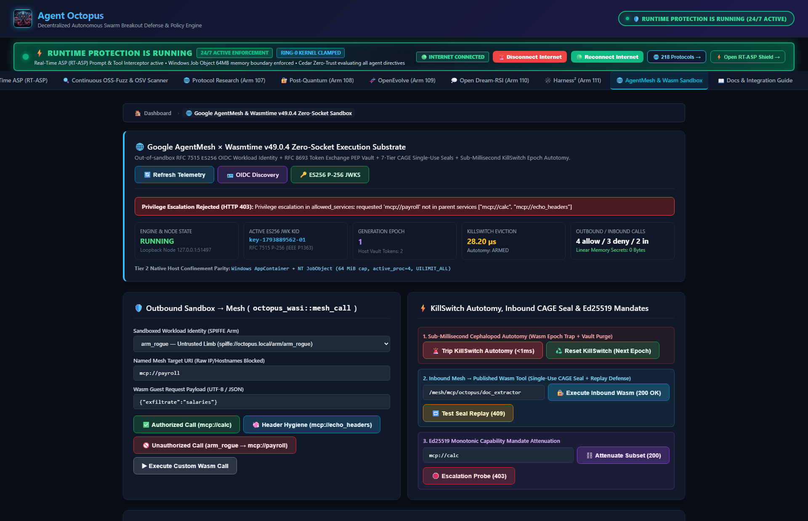
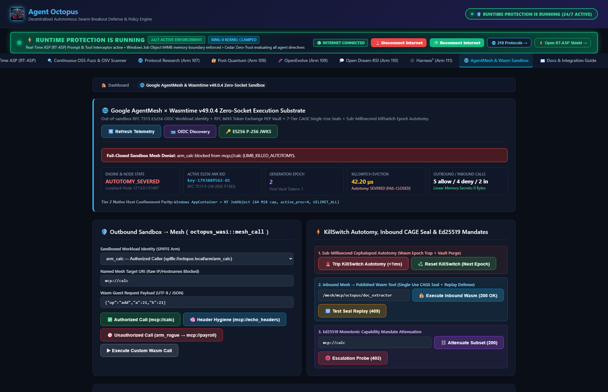

# Google AgentMesh (`v0.2.0`) x AgentOctopus (`wasmtime v49.0.4`) Zero-Socket Sandbox Integration

> **Upstream Issue Alignment**: Built for [`google/agentmesh#734`](https://github.com/google/agentmesh/issues/734) (*"Help wanted: real-world integrations, examples and tests across gateways, IdPs, sandboxes and clouds"*) and the [AgentMesh Security Architecture](https://google.github.io/agentmesh/docs/contributing/security-architecture/).

---

## 1. Topology & End-to-End Security Boundaries

`AgentOctopus` provides a cross-platform (`Linux`, `macOS`, `Windows`) capability-sandbox runtime (`wasmtime v49.0.4`) that enrolls isolated workloads onto an unmodified **`google/agentmesh v0.2.0`** mesh (`agentmesh-one` + `office-node` + `edge-node`), strictly separating **sandbox isolation** from **platform workload identity**, **mesh transport**, and **task-scoped Biscuit authorization**:

```mermaid
flowchart LR
    subgraph Guest["Untrusted Tier 1 Wasmtime v49.0.4 Guest (64 MiB, 0 Sockets, 0 Secrets)"]
        W["WASM_MESH_CALLER_WAT / Virtual Stream Client"]
    end

    subgraph HostPEP["Host Supervisor & PEP Bridge (AgentOctopus)"]
        P["octopus_wasi::mesh_call Pore"]
        I["OidcLoopbackServer (ES256 P-256 + JWKS Rotation)"]
        M["Ed25519 AttenuatedMandate + Mathematical SSRF Filter"]
        V["AgentMeshPepBridge (RFC 8693 Form-Encoded Vault + RFC 7009 Revoke)"]
        C["CAGE Single-Use RoutingSeal Verifier"]
        K["KillSwitch (<1ms Epoch Trap + Vault Purge)"]
    end

    subgraph Mesh["Unmodified google/agentmesh v0.2.0 Multi-Node Mesh"]
        E["edge-node (POST /oauth/token, /oauth/revoke, /mesh/<peer-id>/mcp/*)"]
        CP["agentmesh-one (--workload-issuer, --allowed-audiences=agentmesh, policy.json)"]
        O["office-node (libp2p + Biscuit Authorizer + office.yaml)"]
        B["Published MCP Backends (calc, payroll, echo-headers, octopus-doc-extractor)"]
    end

    W -->|"Logical URI (mcp://calc) + Payload Bytes"| P
    P --> M
    M --> V
    I -->|"Short-Lived ES256 JWT (sub=spiffe://agentoctopus.local/arm/...)"| V
    CP -->|"OIDC Discovery + /.well-known/jwks.json"| I
    V -->|"RFC 8693 Token Exchange (scope, seal=true)"| E
    E <-->|"Enrollment, Policy & Border Crossing Audit"| CP
    V -->|"Strips Authorization/Cookie; Injects X-Mesh-Authentication"| E
    E <-->|"libp2p + Attenuated Biscuit"| O
    O -->|"Strips X-Mesh-Authentication; Injects X-Mesh-Principal"| B
    K -->|"Engine::increment_epoch() + Purge (arm_id, epoch)"| Guest
    K --> V
    B -.->|"Inbound Published Wasm Tool"| C
```



### Architectural Boundary Matrix (`google/agentmesh#734`)

| Responsibility | Enforcing Layer | Concrete Mechanism & Source File |
| :--- | :--- | :--- |
| **Memory, CPU & Zero-Socket Sandbox Confinement** | `AgentOctopus` Tier 1 (`wasmtime v49.0.4`) & Tier 2 Native OS Sandbox | 64 MiB linear memory cap, deterministic Cranelift fuel + epoch interruption, zero ambient WASI sockets/FS ([`wasm_tier1.rs`](../src/security/wasm_tier1.rs)); Windows AppContainer + Job Object ([`windows_sandbox.rs`](../src/security/windows_sandbox.rs)) and Linux `PR_SET_NO_NEW_PRIVS` + Landlock LSM + 18-syscall `seccomp-BPF` + `RLIMIT_AS` ([`linux_sandbox.rs`](../src/security/linux_sandbox.rs)). |
| **Workload Platform Identity (OIDC / JWKS)** | `OidcLoopbackServer` + `OctopusOidcActorIssuer` | Per-`(arm_id, epoch)` decoupled SPIFFE subject (`spiffe://agentoctopus.local/arm/<arm_id>/epoch/<epoch>`), HTTP `iss = http://127.0.0.1:<port>`, `aud = agentmesh`, RFC 7515 `ES256` (`P-256` raw 64-byte IEEE P1363 `R\|\|S` with `x` and `y` coordinates), `current` + `retired` key rotation, bounded `jti` anti-replay, and `<= 5s` clock-skew tolerance ([`oidc_actor_issuer.rs`](../src/security/agentmesh/oidc_actor_issuer.rs)). |
| **Out-of-Sandbox Token Exchange, Biscuit Narrowing & Header Hygiene** | `AgentMeshPepBridge` + `edge-node` (`v0.2.0`) | Wasm guests pass only logical URIs (`mcp://`, `a2a://`, `inference://`, `egress://`) and payload bytes. The host PEP exchanges the workload JWT via `application/x-www-form-urlencoded` RFC 8693 `POST /oauth/token` (supporting task-scoped `scope` + `seal=true` Biscuit `tar_block` attenuation), discovers provider `PeerID`s via `GET /mesh/service/discover`, strips caller `Authorization`/`Cookie`/`X-Mesh-*` headers, injects `X-Mesh-Authentication`, and verifies zero JWT/Biscuit bytes exist in post-execution Wasm memory ([`pep_bridge.rs`](../src/security/agentmesh/pep_bridge.rs)). |
| **Mesh Policy Enforcement & Identity Propagation** | `agentmesh-one` + `office-node` (`v0.2.0`) | `agentmesh-one` verifies workload JWTs via `--workload-issuer` OIDC discovery and logs `Border Crossing` decisions. `office-node` verifies Biscuit capabilities over `libp2p`, strips `X-Mesh-Authentication` before forwarding, and injects verified `X-Mesh-Principal` + `X-Mesh-Roles` headers to upstream MCP backends ([`policy.json`](../examples/agentmesh-wasm-sandbox/policy.json), [`office.yaml.tmpl`](../examples/agentmesh-wasm-sandbox/office.yaml.tmpl)). |
| **Revocation & Sub-Millisecond Non-Cooperative Autotomy** | RFC 7009 `/oauth/revoke` + `KillSwitch` | `POST /oauth/revoke` (`token=<biscuit>`) immediately invalidates compromised Biscuits on `edge-node`; locally, tripping `KillSwitch` increments `wasmtime::Engine::increment_epoch()` (trapping infinite-loop Wasm guests mid-instruction), cancels in-flight streams, and purges cached host tokens in `< 1ms` ([`mod.rs`](../src/security/agentmesh/mod.rs)). |

---

## 2. Reproducible Cross-Platform Commands (`Linux`, `macOS`, `Windows`)

### Pinned Versions
- **Upstream Mesh Binaries**: `google/agentmesh v0.2.0` (`agentmesh-one` + `agentmesh-node`, SHA-256 verified against upstream `checksums.txt` across `Linux_x86_64`, `Linux_arm64`, `Darwin_arm64`, `Darwin_x86_64`, `Windows_x86_64`, and `Windows_arm64`)
- **Rust Toolchain**: `rustc` stable (`edition = "2021"`)
- **WebAssembly Runtime**: `wasmtime v49.0.4` (`cranelift`, `runtime`, `wat`, `default-features = false`)

### Mode A — Live Multi-Node E2E against Official `google/agentmesh v0.2.0` Binaries

#### Linux & macOS (or Windows Git Bash)
```bash
./examples/agentmesh-wasm-sandbox/run.sh
```

#### Windows PowerShell
```powershell
powershell -ExecutionPolicy Bypass -File examples\agentmesh-wasm-sandbox\run.ps1
```

Both launchers download the official `google/agentmesh v0.2.0` archive into `examples/agentmesh-wasm-sandbox/.run/bin/`, verify its exact SHA-256 digest, boot `OidcLoopbackServer` + `agentmesh-one` + `office-node` + `edge-node` + a local Streamable HTTP MCP/Wasmtime backend on `127.0.0.1` ephemeral ports, and run all 8 live verification cases (`cargo run --example agentmesh_live_v020_e2e`).

### Mode B — Offline Embedded Reference Suite (No Network Download Required)
```bash
# 1. Run the 6-stage offline embedded sandbox demonstration
cargo run --example agentmesh_wasm_sandbox_demo

# 2. Run embedded integration & adversarial stress suites
cargo test --test agentmesh_integration_tests -- --nocapture
cargo test --test agentmesh_m1_adversarial_stress_tests -- --nocapture

# 3. Run unit tests for OIDC/PEP/Mandates and Linux seccomp-BPF confinement
cargo test --lib security::agentmesh
cargo test --lib security::linux_sandbox
```

### Mode C — Interactive Web Dashboard (Tab 17: `AgentMesh & Wasm Sandbox`)
```bash
cargo run --bin start -- --console
python scripts/test_all_submenus.py
```

---

## 3. Captured Verification Evidence

### 3.1 Live Multi-Node `google/agentmesh v0.2.0` Output (`./examples/agentmesh-wasm-sandbox/run.sh`)
```text
=========================================================================
  AgentOctopus x google/agentmesh v0.2.0 -- Live Multi-Node E2E Suite
=========================================================================
  [boot] OIDC workload issuer ready at http://127.0.0.1:63235
  [boot] Local Streamable HTTP MCP + Wasmtime backend ready on 127.0.0.1:63236
  [boot] agentmesh-one (v0.2.0) ready at http://127.0.0.1:63237
  [boot] office-node (v0.2.0) enrolled & ready on 127.0.0.1:12787
  [boot] edge-node (v0.2.0) enrolled & ready at http://127.0.0.1:12820
  [mesh] Discovered office-node provider PeerID over libp2p DHT: 12D3KooWBXNeXM9HMiN1EfTjbzdwEgXCNuiyyER32SKiJTh9yvSt
  [PASS] Case 1: Allowed Wasm -> libp2p -> mcp://calc => 42 (0 JWT/Biscuit bytes in Wasm memory)
  [PASS] Case 2: Header hygiene & identity propagation verified (0 leaked secrets; x-mesh-principal=spiffe://agentoctopus.local/arm/arm_calc/epoch/0)
  [PASS] Case 3: Denied service (`arm_calc` -> `mcp://payroll`) refused by office-node (403 -> Wasm -5)
  [PASS] Case 4: Sibling isolation verified (`arm_rogue` refused `mcp://calc` with 403 -> Wasm -5)
  [PASS] Case 5: Sealed task Biscuit (`scope=mcp://calc&seal=true`) allowed `mcp://calc` (200) and refused `mcp://echo-headers` (403)
  [PASS] Case 6: Wrong `aud`, wrong `iss`, and expired JWTs rejected at /oauth/token; fresh JWT exchange recovered (200)
  [PASS] Case 7: Published Wasm tool (`mcp://octopus-doc-extractor`) executed across libp2p for `arm_calc` (200) and denied `arm_rogue` (403)
  [PASS] Case 8: RFC 7009 `/oauth/revoke` blocked Biscuit replay & KillSwitch trapped infinite-loop Wasm guest (vault purge 33 us, total 40 us)
-------------------------------------------------------------------------
  Verified `agentmesh-one` & `office-node` structured audit logs (`Border Crossing` + `AuthZ Denied`).
  ALL 8 LIVE GOOGLE/AGENTMESH v0.2.0 E2E CASES PASSED.
=========================================================================
```

### 3.2 Live Dashboard Verification Screenshots (Tab 17: `agentmesh-runtime`)

#### Authorized Outbound Wasm Mesh Call & Header Hygiene (`200 OK`, Zero Secrets in Linear Memory)


#### Sibling Identity Isolation & Mandate Escalation Denial (`403 Forbidden`, `WASI_ERR_ACCESS_DENIED = -5`)


#### Sub-Millisecond KillSwitch Autotomy (`wasmtime::Engine::increment_epoch()` + Host Vault Purge)


---

## 4. Honest Limitations, Tradeoffs & Follow-Ups (`#734` Reporting Checklist)

1. **Loopback OIDC Discovery vs. Production SPIRE / Cloud Workload Identity**:
   - For zero-dependency local reproducibility across Linux, macOS, and Windows, `OidcLoopbackServer` serves HTTP OIDC discovery on `127.0.0.1:<port>` (matching `agentmesh-one`'s loopback HTTP exemption for `--workload-issuer`). Non-loopback deployments require HTTPS OIDC discovery (e.g., SPIRE `oidc-discovery-provider` behind TLS or cloud workload identity federation).
2. **Credential & Policy Cache Propagation Window**:
   - Role binding edits pushed to `agentmesh-one` (`POST /policies`) propagate to `agentmesh-node` peers on `--control-plane-sync-interval` (`5s` in the example; `15m` upstream default), while already-minted standing Biscuits remain valid until expiry unless explicitly invalidated via `POST /oauth/revoke` or host `KillSwitch` eviction.
3. **Wasm Guest Socket Allowlist**:
   - Off-the-shelf Wasm modules importing raw `wasi_snapshot_preview1` POSIX TCP sockets (`sock_accept` / `sock_connect`) are intentionally rejected by `WasmTier1Executor` so untrusted guests cannot bypass the host PEP or dial raw IPs. Guests use `octopus_wasi::mesh_call` or virtual stream descriptors (`mesh_stream_open`/`write`/`read`/`close`), while unmodified native binaries run in Tier 2 OS confinement (`AppContainer` on Windows; `Landlock` + `seccomp-BPF` on Linux).

---

## 5. Complete Test Traceability Matrix

| Suite / Command | Test Count | Key Verified Properties |
| :--- | :---: | :--- |
| `./examples/agentmesh-wasm-sandbox/run.sh` (`agentmesh_live_v020_e2e`) | **8 live cases** | Official `agentmesh-one` + `office-node` + `edge-node` (`v0.2.0`), OIDC `--workload-issuer`, `libp2p` DHT discovery, `X-Mesh-Principal` propagation, `403` policy/sibling denials, `scope` + `seal=true` Biscuit `tar_block`, wrong `iss`/`aud`/expired JWT rejection, RFC 7009 `/oauth/revoke`, `<1ms` Wasmtime epoch trap. |
| `cargo test --lib security::agentmesh` | **34** | `ES256` IEEE P1363 signatures, DER rejection, JWKS `x`/`y` rotation, `<=5s` clock drift, `jti` anti-replay, RFC 8693 form-urlencoded exchange, chunked HTTP + SSE decoding, header stripping, Zero-MI sanitization, Ed25519 mandate chains, `<1ms` KillSwitch eviction. |
| `cargo test --lib security::linux_sandbox` | **6** | `x86_64` & `aarch64` BPF bytecode generation, 18-syscall socket blocking (`EACCES`), arch-mismatch `SECCOMP_RET_KILL_PROCESS`, resource ceiling defaults. |
| `cargo test --test agentmesh_m1_adversarial_stress_tests` | **16** | 500-entry concurrent KillSwitch `<1ms` benchmark, `CancellationToken` mid-stream abort, signed `POST /mesh/revoke`, header smuggling/shadowing defense, mutual PEP channel proof. |
| `cargo test --test agentmesh_integration_tests` | **9** | Embedded E2E `WASM_MESH_CALLER_WAT` allowed/denied flows, zero-secret linear memory scan, virtual WASI streams, inbound CAGE `RoutingSeal` `200` -> `409` replay rejection, infinite-loop Wasm epoch trap, Web API handlers. |
| `python scripts/test_all_submenus.py` | **93 checks** | All 17 WebUI dashboard tabs including live HTTP verification of `/.well-known/openid-configuration`, `/.well-known/jwks.json`, `/api/agentmesh/*`, and `<1ms` KillSwitch trip/reset. |
