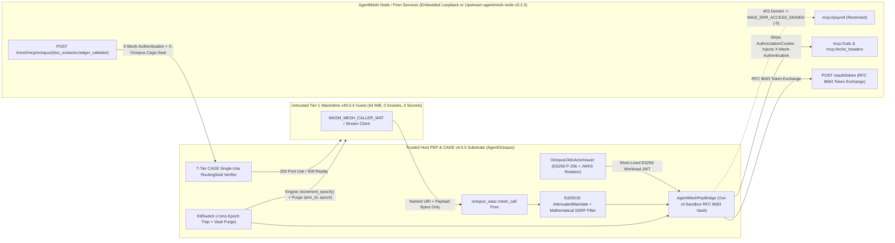

# Google AgentMesh × AgentOctopus (`wasmtime v49.0.4`) Zero-Socket Sandbox Integration

> **Upstream Issue Alignment**: Built directly against [`google/agentmesh#734`](https://github.com/google/agentmesh/issues/734) (*"Help wanted: real-world integrations, examples and tests across gateways, IdPs, sandboxes and clouds"*) and the [AgentMesh Security Architecture](https://google.github.io/agentmesh/docs/contributing/security-architecture/).

---

## 1. Topology & End-to-End Architecture

`AgentOctopus` serves as the **host-confined WebAssembly (`wasmtime v49.0.4`) and OS sandbox execution substrate** beneath `google/agentmesh` (`v0.2.0`), strictly separating **sandbox isolation** from **mesh transport, workload identity, and task-scoped authorization**:



### Architectural Boundary Matrix (`google/agentmesh#734`)

| Responsibility | Enforcing Layer | Concrete Mechanism & Source File |
| :--- | :--- | :--- |
| **Memory, CPU & Zero-Socket Sandbox Confinement** | `AgentOctopus` Tier 1 (`wasmtime v49.0.4`) & Tier 2 Native OS Sandbox | 64 MiB linear memory cap, deterministic Cranelift fuel + epoch interruption, zero ambient WASI sockets/FS ([`wasm_tier1.rs`](../src/security/wasm_tier1.rs)); Windows AppContainer + Job Object ([`windows_sandbox.rs`](../src/security/windows_sandbox.rs)) and Linux `PR_SET_NO_NEW_PRIVS` + Landlock LSM + 18-syscall `seccomp-BPF` + `RLIMIT_AS` ([`linux_sandbox.rs`](../src/security/linux_sandbox.rs)). |
| **Workload Platform Identity (OIDC / JWKS)** | `OctopusOidcActorIssuer` + `OsProtectedKeyBroker` | Per-`(arm_id, epoch)` SPIFFE subject (`spiffe://octopus.local/arm/<arm_id>`), RFC 7515 `ES256` (`P-256` raw 64-byte IEEE P1363 `R\|\|S`), RFC 7517 JWKS with `current` + `retired` key rotation, bounded `jti` anti-replay, `±5s` clock-skew tolerance, and Windows DPAPI / zeroizing key protection ([`oidc_actor_issuer.rs`](../src/security/agentmesh/oidc_actor_issuer.rs), [`key_broker.rs`](../src/security/agentmesh/key_broker.rs)). |
| **Credential Isolation & Header Hygiene (`egress-office` Pattern)** | `AgentMeshPepBridge` (Out-of-Sandbox Host Vault) | Wasm guests pass only named URIs (`mcp://`, `a2a://`, `inference://`, `egress://`) and payload bytes. The host PEP strips caller `Authorization`, `Proxy-Authorization`, `Cookie`, `Set-Cookie`, and `X-Mesh-*` headers, exchanges the workload JWT via RFC 8693 (`POST /oauth/token`), injects `X-Mesh-Authentication` outside linear memory, and scans post-execution guest memory (`linear_memory_zero_secret_verified = true`) ([`pep_bridge.rs`](../src/security/agentmesh/pep_bridge.rs)). |
| **Offline Sub-Agent Delegation & SSRF Prevention** | `AttenuatedMandate` | Ed25519-chained delegation hops binding `delegatee_verifying_key`, monotonic intersection ($\text{Services}_{N+1} \subseteq \text{Services}_N$), segregated `allowed_services` vs. `allowed_publish` grants, zero holder-supplied Datalog rules, and mathematical `Ipv4Addr`/`Ipv6Addr`/`:port` SSRF rejection ([`mandate_attenuation.rs`](../src/security/agentmesh/mandate_attenuation.rs)). |
| **Inbound Tool Governance & Single-Use Actuation** | `CageGovernanceEngine` + `AgentMeshServingNode` | Published Wasm tools (`mcp://octopus/doc_extractor`, `mcp://octopus/ledger_validator`) require valid `X-Mesh-Authentication` (`401`/`403` on missing, expired, or unauthorized caller) **and** an unconsumed HMAC-chained CAGE `CageRoutingSeal` (`200 OK` on first call, `409 Conflict` on replay) ([`serving_node.rs`](../src/security/agentmesh/serving_node.rs)). |
| **Sub-Millisecond Autotomy & In-Flight Cancellation** | `KillSwitch` + `CancellationToken` | Tripping autotomy increments `wasmtime::Engine::increment_epoch()` (trapping non-cooperative infinite-loop Wasm guests mid-instruction), cancels active outbound streams via `CancellationToken`, and purges cached `(arm_id, epoch)` tokens in **`< 1,000 µs`** ([`mod.rs`](../src/security/agentmesh/mod.rs)). |

---

## 2. Exact Pinned Versions & Repeatable Commands

### Pinned Versions
- **Rust Toolchain**: `rustc 1.99.1` (`edition = "2021"`)
- **WebAssembly Runtime**: `wasmtime v49.0.4` (`cranelift`, `runtime`, `wat`, `default-features = false`)
- **Cryptography**: `p256 v0.13` (`ES256`), `ed25519-dalek v2.1`, `ml-kem v0.3.2` (`ML-KEM-768`), `ml-dsa v0.1.1`, `zeroize v1.8`
- **Upstream Interop Target**: `google/agentmesh v0.2.0` (`AGENTMESH_UPSTREAM_URL`)

### Mode A — Self-Contained Runnable Example & Integration Test Suite (Zero External Daemons Required)
```bash
# 1. Run the 6-stage end-to-end runnable sandbox demonstration
cargo run --example agentmesh_wasm_sandbox_demo

# 2. Run the AgentMesh + Wasmtime E2E integration suite
cargo test --test agentmesh_integration_tests -- --nocapture

# 3. Run the adversarial stress & concurrency benchmark suite (500-token <1ms eviction, stream abort, header smuggling)
cargo test --test agentmesh_m1_adversarial_stress_tests -- --nocapture

# 4. Run unit tests for OIDC/PEP/Mandates and Linux Tier 2 seccomp-BPF confinement
cargo test --lib security::agentmesh
cargo test --lib security::linux_sandbox
```

### Mode B — Live Interop with an External `agentmesh-node` (`v0.2.0`) Sidecar
Point `AGENTMESH_UPSTREAM_URL` at a running `agentmesh-node` listener; `AgentOctopus` exposes `GET /.well-known/openid-configuration` and `GET /jwks` (`ES256` `P-256`) for workload enrollment and routes outbound `octopus_wasi::mesh_call` traffic through the external node while retaining local Wasmtime + CAGE + KillSwitch enforcement:
```bash
AGENTMESH_UPSTREAM_URL=http://127.0.0.1:8080 cargo run --example agentmesh_wasm_sandbox_demo
```

### Mode C — Interactive Web Dashboard (Tab 17: `AgentMesh & Wasm Sandbox`) & Exhaustive Submenu Suite
```bash
# Start the local dashboard server on http://127.0.0.1:5005
cargo run --bin start -- --console

# Verify all 17 dashboard tabs and AgentMesh endpoints end-to-end
python scripts/test_all_submenus.py
```

---

## 3. Captured Verification Evidence

### 3.1 Runnable Demonstration Output (`cargo run --example agentmesh_wasm_sandbox_demo`)
```text
================================================================================
  Google AgentMesh x AgentOctopus (Wasmtime v49.0.4) Sandbox Integration Demo
================================================================================
[1/6] OIDC Actor Discovery & ES256 JWKS Online
      Node Port: Some(50624) | Active P-256 KID: key-1793889107-01
      Tier 2 Host Confinement: Windows AppContainer + NT JobObject (64 MiB cap, active_proc=4, UILIMIT_ALL)
[2/6] Outbound Sandbox -> Mesh Authorized (arm_calc -> mcp://calc & mcp://echo_headers)
      Wasm Exit: 122 | Fuel: 224 | Linear Memory Zero-Secret Scan: true
[3/6] Sibling Identity Isolation Verified (arm_rogue -> mcp://payroll & mcp://calc)
      Verdict: DENIED inside Wasm (exit_code = -5 WASI_ERR_ACCESS_DENIED)
[4/6] Ed25519 Monotonic Mandate Chain & Mathematical SSRF URI Filter Verified
      Mandate Depth: 1 | Allowed Services: {"mcp://calc"} | Escalation & Raw IP Blocked
[5/6] Inbound Mesh -> Published Wasm Tool (mcp://octopus/doc_extractor) Verified
      Unauth: 401 | Expired JWT: 401 | Valid Seal: 200 (fuel=2233) | Replay: 409 Conflict
[6/6] Sub-Millisecond KillSwitch Autotomy & Wasm Epoch Trap Verified
      Revocation Latency: 40.30 us (< 1,000 us SLA) | New Epoch: 1 | Cached Vault Tokens: 0
================================================================================
  ALL 6 GOOGLE AGENTMESH X WASMTIME V49.0.4 INVARIANTS VERIFIED SUCCESSFULLY
================================================================================
```

### 3.2 Live Dashboard Verification Screenshots (Tab 17: `agentmesh-runtime`)

#### Authorized Outbound Wasm Mesh Call & Header Hygiene (`200 OK`, Zero Secrets in Linear Memory)


#### Sibling Identity Isolation & Mandate Escalation Denial (`403 Forbidden`, `WASI_ERR_ACCESS_DENIED = -5`)


#### Sub-Millisecond KillSwitch Autotomy (`wasmtime::Engine::increment_epoch()` + Host Vault Purge)


---

## 4. Honest Limitations, Tradeoffs & Follow-Ups (`#734` Reporting Checklist)

1. **Embedded Reference Node vs. Full `libp2p` Router Mesh**:
   - Out of the box, `AgentOctopus` starts an embedded Rust HTTP/RFC-8693 serving node on `127.0.0.1:0` (plus pure-Rust `ML-KEM-768` + `Ed25519` + `ChaCha20-Poly1305` WAN framing in [`wan_transport.rs`](../src/security/agentmesh/wan_transport.rs)) so CI and single-workstation users can run every test offline without Docker or Go. For full multi-cluster `libp2p` DHT discovery and Biscuit policy evaluation across clouds, pair `AgentOctopus` with upstream `agentmesh-node` via `AGENTMESH_UPSTREAM_URL`.
2. **Wasm Guest Socket Compatibility**:
   - Off-the-shelf Wasm modules compiled against ambient `wasi_snapshot_preview1` POSIX TCP sockets (`sock_accept` / `sock_connect`) are intentionally rejected by `WasmTier1Executor`'s import allowlist (`TIER1_AMBIENT_IMPORT_FORBIDDEN`). Guests use either the atomic `octopus_wasi::mesh_call` pore or the 16-slot virtual stream descriptor shim (`mesh_stream_open`/`write`/`read`/`close`), while unmodified native binaries run in Tier 2 OS confinement (`AppContainer` on Windows; `Landlock` + `seccomp-BPF` on Linux).
3. **Ubuntu 24.04+ Unprivileged User Namespace Restrictions**:
   - On Linux kernels where AppArmor restricts unprivileged `unshare(CLONE_NEWUSER | CLONE_NEWNET)` with `EPERM`, [`linux_sandbox.rs`](../src/security/linux_sandbox.rs) enforces mandatory 18-syscall `seccomp-BPF` socket blocking (`SECCOMP_RET_ERRNO | EACCES` on `x86_64` and `aarch64`) + `PR_SET_NO_NEW_PRIVS` + Landlock LSM so network creation inside Tier 2 still fails closed at the kernel syscall boundary.

---

## 5. Complete Test Traceability Matrix

| Suite / Command | Test Count | Key Verified Properties |
| :--- | :---: | :--- |
| `cargo test --lib security::agentmesh` | **31** | `ES256` IEEE P1363 signatures, DER rejection, JWKS rotation, `±5s` clock drift, `jti` anti-replay, RFC 8693 token exchange, header stripping, Zero-MI sanitization, Ed25519 mandate chains, DPAPI key broker, `ML-KEM-768` WAN frames, `<1ms` KillSwitch eviction. |
| `cargo test --lib security::linux_sandbox` | **6** | `x86_64` & `aarch64` BPF bytecode generation, 18-syscall socket blocking (`EACCES`), arch-mismatch `SECCOMP_RET_KILL_PROCESS`, resource ceiling defaults, fail-closed non-Linux guard. |
| `cargo test --test agentmesh_m1_adversarial_stress_tests` | **16** | 500-entry concurrent KillSwitch `<1ms` benchmark, `CancellationToken` mid-stream abort, signed `POST /mesh/revoke`, header smuggling/shadowing defense, mutual PEP channel proof, Zero-MI steganography scrubbing. |
| `cargo test --test agentmesh_integration_tests` | **9** | Full E2E `WASM_MESH_CALLER_WAT` allowed/denied flows, zero-secret linear memory scan, virtual WASI streams, inbound CAGE `RoutingSeal` `200` -> `409` replay rejection, infinite-loop Wasm epoch trap, Linux BPF & DPAPI/PQC, Web API handlers. |
| `python scripts/test_all_submenus.py` (Tab 17) | **9** | Live HTTP verification of `/.well-known/openid-configuration`, merged `/.well-known/jwks.json`, `/api/agentmesh/*`, `/mesh/mcp/octopus/doc_extractor` (`401`/`200`/`409`), and `<1ms` KillSwitch trip/reset. |
