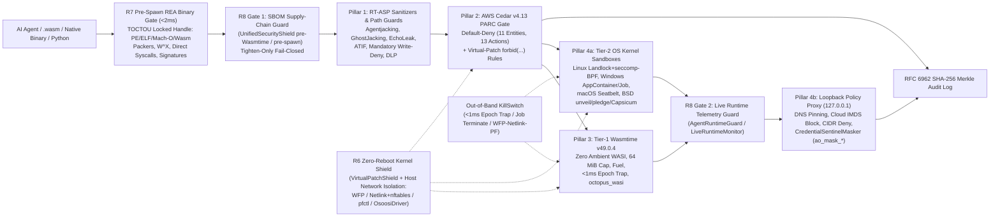

# Architecture and Security Model

**Docs:** [Hub](README.md) | [Architecture & Security](ARCHITECTURE_AND_SECURITY_MODEL.md) | [Kernel Shield](KERNEL_PATCHING_AND_ZERO_BREAKOUT_SHIELD.md) | [CLI & Policy](CLI_AND_POLICY_REFERENCE.md) | [Operations & API](OPERATIONS_AND_API_GUIDE.md) | [AgentMesh + Wasm](AGENTMESH_WASM_INTEGRATION.md) | [Red Teaming](ADVERSARIAL_DEFENSE_AND_RED_TEAMING.md) | [Root README](../README.md)

AgentOctopus is a single-binary Rust runtime engineered so that **every allow/deny decision is 100% deterministic**. It pairs with **`google/agentmesh`** (cross-machine SPIFFE workload identity, Biscuit Datalog authority, `libp2p` transport, and out-of-band `SecuritySignalEvent` webhooks) as the local host and process containment boundary, replacing multi-service Python governance stacks such as CAGE.

---

## End-to-End Deterministic Containment Pipeline

Every workload launched via `octopus run` or enrolled as a contained arm traverses deterministic pre-flight, binary/SBOM, authorization, sandbox, and egress gates before touching host resources, while an out-of-band `KillSwitch` can sever compromised workloads in `<1ms` and an append-only SHA-256 Merkle audit log records every decision:

---

## The 4 Deterministic Containment Pillars

### 1. RT-ASP Sanitizers and Mandatory Write-Deny Guards

Sources: [`src/security/rasp/`](../src/security/rasp/), [`src/security/agent_hooks.rs`](../src/security/agent_hooks.rs), [`src/security/sensitive_paths.rs`](../src/security/sensitive_paths.rs), [`src/security/atif_scan.rs`](../src/security/atif_scan.rs), [`src/security/semantic_dlp.rs`](../src/security/semantic_dlp.rs).

- **Agentjacking and GhostJacking Defense**: Strips invisible Unicode tag characters, bidirectional overrides, zero-width smuggling runs, and zero-area / off-screen adversarial DOM directives before prompt or tool ingestion.
- **EchoLeak Defanging**: Neutralizes markdown image exfiltration (``) and HTML link-prefetch exfiltration inside untrusted model outputs.
- **ATIF Stage-1 Interception (`AtifScanner`)**: Detects high-severity container/harness probes (`/proc/1/environ`, `curl --noproxy`, `unshare`/`nsenter`, Kubernetes service-account token reads, and Cloud IMDS metadata probes) and validates declared tools and host provenance.
- **Sensitive Path & Mandatory Write-Deny Guards**: `octopus run` pre-flight (`src/security/sensitive_paths.rs`) unconditionally rejects `allow_read`/`allow_write` targets matching sensitive system/credential stores (`.ssh`, `.aws`, `.kube`, `.gnupg`, `/etc/shadow`, SAM/LSASS stores) and enforces mandatory write-deny on persistence/IDE/agent config files (`.bashrc`, `.bash_profile`, `.zshrc`, `.zprofile`, `.profile`, `.git/hooks`, `.githooks`, `.git/config`, `.git/modules`, `.gitconfig`, `.gitmodules`, `.mcp.json`, `.vscode/`, `.idea/`, `.claude/commands/`, `.claude/agents/`, `.ripgreprc`) as well as pinned parent directories (`.git`, `.githooks`, `.vscode`, `.idea`, `.claude`).
- **Semantic Command & DLP Inspection**: Evaluates shell/command ASTs and inspects outbound HTTP bodies/headers for credential or PII exfiltration.

### 2. AWS Cedar v4.13 PARC Authorization Gate

Sources: [`src/security/cedar_arm/`](../src/security/cedar_arm/), [`src/containment_ring/cedar_gate.rs`](../src/containment_ring/cedar_gate.rs).

- Powered by `cedar-policy` `v4.13.0` under `ValidationMode::Strict`.
- Evaluates **Principal, Action, Resource, Context (PARC)** tuples over **11 entity types** (`Agent`, `Document`, `Ledger`, `NetworkTarget`, `SystemPolicy`, `DecoyTrap`, `KernelSubstrate`, `Command`, `FilePath`, `Tool`, `Host`) and **13 actions** (`extract`, `write`, `egress`, `notify`, `change_security_policy`, `quarantine`, `kernel_enforce`, `evaluate`, `inbound_perimeter`, `exec`, `fs_read`, `fs_write`, `tool_call`).
- Default-deny semantics: every action requires an explicit `permit` and must survive all active `forbid` rules, including dynamically hot-loaded R6 CVE virtual-patch `forbid(...)` rules (`src/research_ingest.rs`) and Dogwood temporal window constraints (`src/security/cedar_arm/temporal/`).
- Full schema reference: [CLI and Policy Reference](CLI_AND_POLICY_REFERENCE.md#aws-cedar-v413-schema-11-entities-and-13-actions).

### 3. Wasmtime v49.0.4 Tier-1 Capability Sandbox

Sources: [`src/security/wasm_tier1.rs`](../src/security/wasm_tier1.rs), [`src/cli/wasm_runner.rs`](../src/cli/wasm_runner.rs), [`src/security/openshell.rs`](../src/security/openshell.rs).

- Executes untrusted `.wasm` and `.wat` guest modules in-process with **zero ambient authority**: no raw POSIX sockets, no host environment variables, no process creation, and no ambient filesystem access.
- **Memory & CPU Ceilings**: `wasmtime::ResourceLimiter` enforces linear memory limits clamped to **`64 KiB..=64 MiB`** (default `64 MiB`) and a `4,096`-element table cap; `Store::set_fuel` halts infinite loops after a deterministic instruction budget (default `2,000,000` fuel units).
- **Sub-Millisecond Autotomy**: `Config::epoch_interruption(true)` lets the out-of-band `KillSwitch` call `Engine::increment_epoch()` to trap runaway guests mid-instruction in `<1ms` (exit code `124` on timeout).
- **Confined Host Pore (`octopus_wasi`)**: Filesystem scratchpad calls route exclusively through `open_confined` (reparse-point/symlink refusal, hardlink rejection `nNumberOfLinks > 1`, and `GetFinalPathNameByHandleW` prefix verification); mesh calls route through `octopus_wasi::mesh_call` and the host PEP (`AgentMeshPepBridge`), keeping raw JWTs and Biscuit tokens strictly out of Wasm linear memory.

### 4. Tier-2 OS Kernel Sandboxes and Loopback Policy Proxy

Sources: [`src/security/linux_sandbox.rs`](../src/security/linux_sandbox.rs), [`src/security/windows_sandbox.rs`](../src/security/windows_sandbox.rs), [`src/security/token_posture.rs`](../src/security/token_posture.rs), [`src/security/macos_sandbox.rs`](../src/security/macos_sandbox.rs), [`src/security/bsd_sandbox.rs`](../src/security/bsd_sandbox.rs), [`src/cli/proxy.rs`](../src/cli/proxy.rs), [`src/cli/run.rs`](../src/cli/run.rs).

- **Native OS Process & Filesystem Confinement**:
  - **Linux (`linux-landlock+seccomp`)**: `PR_SET_NO_NEW_PRIVS`, Landlock LSM path rules, `RLIMIT_AS` / `RLIMIT_CPU` / `RLIMIT_NOFILE` / `RLIMIT_CORE=0`, and `seccomp-BPF` (blocking raw sockets when no domains/IPC are allowed, plus R6 CVE EoP/escape syscall clamps and `clone3` `ENOSYS`).
  - **Windows (`windows-deelevated+job` / `windows-appcontainer+job`)**: `--sandbox standard` creates a de-elevated restricted token (`DISABLE_MAX_PRIVILEGE | LUA_TOKEN`, `BUILTIN\Administrators` deny-only, Medium integrity) verified while `CREATE_SUSPENDED` before `ResumeThread` inside a `WindowsJobObject` (`ActiveProcessLimit`, `ProcessMemoryLimit`, `KILL_ON_JOB_CLOSE`). `--sandbox strict` creates an ephemeral AppContainer (`S-1-15-2-...`) + Named Pipe Cedar FS IPC (`\\.\pipe\octopus-cedar-...`) + process mitigation policy mask (`EXTENSION_POINT_DISABLE`, `IMAGE_LOAD_NO_REMOTE`, `IMAGE_LOAD_NO_LOW_LABEL`, `IMAGE_LOAD_PREFER_SYSTEM32`, optional `WIN32K_SYSTEM_CALL_DISABLE`).
  - **macOS (`macos-seatbelt-sbpl`)**: Fail-closed Seatbelt SBPL (`(version 1) (deny default)`) with `/var` -> `/private/var` and `/tmp` -> `/private/tmp` canonicalization, R6 kernel-extension/IOKit denies, and `libproc` (`proc_listchildpids`) recursive subtree termination.
  - **BSD (`bsd-freebsd`, `bsd-openbsd`, `bsd-netbsd`)**: OpenBSD `unveil()` + `pledge()` + `setrlimit`; FreeBSD `procctl(PROC_NO_NEW_PRIVS_CTL)` + Capsicum `cap_enter()`; NetBSD `setrlimit` (`RLIMIT_CORE=0`, `RLIMIT_DATA`).
- **Loopback HTTP/CONNECT Policy Proxy (`127.0.0.1`)**:
  - Validates exact `host` or `host:port` rules (no wildcards `*`, `denied_domains` takes strict precedence over `allowed_domains`).
  - Pins resolved DNS IPs to defeat DNS rebinding, blocks Cloud IMDS (`169.254.169.254` and `100.100.100.200`), blocks unspecified/restricted CIDRs, blocks unlisted loopback ports, and rejects userinfo (`user:pass@host`) smuggling.
  - **Credential Isolation (`CredentialSentinelMasker`)**: Replaces sensitive env vars in `credentials.mask_env` with opaque `ao_mask_*` sentinels inside the child environment and injects real secrets only on HTTPS requests targeting explicitly approved `credentials.inject_hosts`.

### SHA-256 Merkle Audit Log

Sources: [`src/core/merkle.rs`](../src/core/merkle.rs), [`src/security/audit.rs`](../src/security/audit.rs), [`src/ledger/`](../src/ledger/).

- Every Cedar authorization, egress proxy decision, R6 virtual-patch receipt (`VirtualPatchShieldReceipt`), and R8 SBOM guard decision is chained into an RFC 6962 SHA-256 Merkle tree and appended to `logs/audit.log` (`GET /api/audit-log`).

---

## R7 Pre-Spawn REA Binary Gate (Under 2ms)

Sources: [`src/security/rea_binary_gate.rs`](../src/security/rea_binary_gate.rs), [`src/security/executable_identity.rs`](../src/security/executable_identity.rs), [`src/security/rate_limit_backoff.rs`](../src/security/rate_limit_backoff.rs), [`src/cli/run.rs`](../src/cli/run.rs).

Requirement R7 adds a fast, pure-Rust pre-execution binary header and direct-syscall gate to `octopus run` before any child process is spawned.

### Explicit Design Boundary: Containment Gate vs. Heavy EDR

`rea_binary_gate` is intentionally engineered as a **`<2ms` pre-exec containment gate** and explicitly avoids heavyweight EDR bloat:
- **Included**: Zero-panic bounds-checked `ByteCursor` parsing over bounded header/section windows, TOCTOU handle locking, packer/entropy/`W^X`/signature checks, and raw direct-syscall stub detection wired into the `ReteEngine` REA fact consumer.
- **Excluded by design**: No Capstone/disassembler graphs, no `capa`/`xori`/`hollows_hunter`-scale full-binary disassembly or live process memory carving inside the core `octopus` runtime.

### TOCTOU-Safe Handle Binding and Scan Caps

1. `open_and_lock_executable_for_cli` (`executable_identity.rs`) locks the target executable handle before inspection (`FILE_SHARE_READ | FILE_FLAG_OPEN_REPARSE_POINT` on Windows; `O_NOFOLLOW` + `fstat` on Unix), eliminating time-of-check/time-of-use swaps.
2. `BinarySource::LockedFile` reads bounded windows and caches verdicts by `KernelFileIdentityKey` `(dev, ino, mtime_sec, mtime_nsec, size, check_catalog_sig)` (`CACHE_CAPACITY_LIMIT = 256`).
3. Strict parse bounds prevent DoS on malformed binaries:
   - `HEADER_WINDOW_BYTES = 65_536` (`64 KiB`)
   - `MAX_SECTION_ENTROPY_BYTES = 262_144` (`256 KiB` per section)
   - `MAX_TOTAL_EXEC_SCAN_BYTES = 524_288` (`512 KiB` total executable scan)
   - `MAX_PE_SECTIONS = 512`, `MAX_PE_LFANEW_BYTES = 16 MiB`, `MAX_ELF_PHDRS = 64`, `MAX_ELF_SHDRS = 128`, `MAX_MACHO_CMDS = 256`, `MAX_MACHO_FAT_ARCHS = 16`, `MAX_STUB_DETAILS = 32`.

### Multi-Format Binary Checks and RETE Bridge

| Format | Detected Signals |
|---|---|
| **PE (32/64-bit)** | Packer markers (`UPX0`/`UPX1`/`UPX2`/`UPX!`/`MPRESS`/`.vmp0..2`/`.themida`/`.aspack`/`.petite`/`.packed`), `W^X` (`IMAGE_SCN_MEM_WRITE \| IMAGE_SCN_MEM_EXECUTE`), executable-section Shannon entropy `>= 6.4` paired with packer/`W^X`/raw-size anomaly (zero false positives on legitimate signed system binaries like `python.exe`), `IMAGE_DIRECTORY_ENTRY_SECURITY` (`WIN_CERT_TYPE_PKCS_SIGNED_DATA`) + optional Windows catalog check, and Hell's Gate / Halo's Gate direct-syscall stubs (`4C 8B D1` / `49 89 CA` + `B8/48 C7 C0/6A/68` + `0F 05` / `CD 2E`). |
| **ELF (32/64-bit LE/BE)** | `PT_LOAD` `PF_W \| PF_X` and `SHF_WRITE \| SHF_EXECINSTR` `W^X` violations, `UPX!` packer markers, packed high-entropy executable segments (`>= 6.4` + anomaly), and raw x86_64 (`syscall`) / ARM64 (`mov x8` + `svc #0`) direct-syscall stub sleds. |
| **Mach-O (32/64-bit & Universal Fat)** | `VM_PROT_WRITE \| VM_PROT_EXECUTE` segments, `LC_CODE_SIGNATURE` (`CSMAGIC_EMBEDDED_SIGNATURE = 0xFADE_0CC0`), `UPX!` / packed segments, and x86_64 Darwin syscall class (`0x2000000`) / ARM64 `mov x16` + `svc #0x80` stub sleds. |
| **Wasm / Shebang Scripts** | `.wasm`/`.wat` magic passes straight to Wasmtime Tier-1; Unix `#!` scripts unwrap 1 level to inspect the target interpreter binary (`cli/run.rs`). |

`BinaryIntegrityVerdict::to_rea_binary_fact(pid)` populates `ReaBinaryFact` (`is_packed`, `direct_syscall_count`, `obfuscation_entropy`, `is_authenticode_signed`, `yara_detections`) into `ReteEngine::evaluate_pre_spawn_rea_gate` (`rate_limit_backoff.rs`). When `binary_integrity.enabled` (default `true`) triggers a violation—or BYOVD driver match, header anomaly, `BinaryFormat::Unknown`, or `require_signed_binaries` failure—`octopus run` fails closed with **exit code `2`** before spawning.

---

## R8 Pure-Rust UnifiedSecurityShield

Sources: [`src/security/latent_shield.rs`](../src/security/latent_shield.rs), [`src/security/latent_shield_weights.json`](../src/security/latent_shield_weights.json), [`src/cli/latent_shield.rs`](../src/cli/latent_shield.rs), [`src/cli/run.rs`](../src/cli/run.rs), [`src/security/wasm_tier1.rs`](../src/security/wasm_tier1.rs), [`src/containment_ring/tiered_executor.rs`](../src/containment_ring/tiered_executor.rs).

Requirement R8 embeds a **pure-Rust, zero-Python** `UnifiedSecurityShield` (`ndarray 0.16` with `serde` + `rand_distr 0.4`; zero BLAS, C toolchain, or Python runtime dependencies).

### Shared LatentWorldModel and Dual Gates

- **`LatentWorldModel`**: Variational encoder (`enc_l1 -> LayerNorm -> SiLU -> enc_l2`), forward latent transition predictor (`pred_l1 -> LayerNorm -> SiLU -> pred_l2`), and semantic decoder (`dec_l1 -> SiLU -> dec_l2`) with `latent_dim = 4`, `hidden = 32`, `obs_dim = 6`, `action_dim = 3`.
- **Embedded Deterministic Weights**: Pre-trained deterministic weights are compiled into the binary via `include_str!("latent_shield_weights.json")` (`95,556` bytes) for microsecond startup and inference, or overridden via `--latent-weights <PATH>` (`MAX_WEIGHTS_JSON_BYTES = 2 MiB`).
- **Gate 1 — `SbomSupplyChainGuard` (`threshold = 0.035`)**: Runs in `octopus run` (when `--baseline-sbom` and `--sbom` are provided) **strictly after** Cedar/RT-ASP/VirtualPatchShield/R7 REA and **strictly before** Wasmtime store instantiation or OS child spawn, and is also exposed standalone via `octopus sbom-guard` (`latent-shield`). `extract_sbom_features` extracts 6 normalized features from CycloneDX JSON (`component_count_norm`, `transitive_edge_ratio`, plus positional ratios for non-standard PURLs, permissive licenses, elevated capabilities, and namespace diversity) and pairs them with `SbomIntent` (`patch`, `minor`, `refactor`). Poisoned dependency/capability jumps exceeding `0.035` fail closed with **exit code `2`**.
- **Gate 2 — `AgentRuntimeGuard` / `LiveRuntimeMonitor` (`threshold = 0.085`)**: Evaluates 6 normalized runtime telemetry signals (`file_reads_norm`, `file_writes_norm`, `child_procs_norm`, `net_sockets_norm`, `mem_delta_norm`, `prompt_entropy_norm`) against action vectors inside `WasmHostState::evaluate_runtime_guard_step`, `TieredExecutionDispatcher`, and `octopus run` runtime monitoring, tripping deterministically on breakout telemetry spikes.

### Tighten-Only Monotonicity and Distinction from D3QN

- **Strict Tighten-Only Monotonicity**: `UnifiedSecurityShield` can **only block/tighten** execution (`block_execution: true` -> exit `2` / runtime kill + Merkle receipt). It can **never** grant permission or override a deny from AWS Cedar, RT-ASP, Wasmtime, OS Sandboxes, R6 Virtual-Patch Shield, or the R7 REA Binary Gate.
- **Fail-Closed Bounds**: Zero `.unwrap()`/`.expect()` on untrusted inputs; immediately returns `block_execution: true` (`surprise_score: f64::MAX`) on `NaN`/`Inf` weights, observations, actions, or thresholds, vector dimension mismatches, symlinks, NUL bytes, or SBOM bounds overflow (`MAX_SBOM_JSON_BYTES = 4 MiB`, `MAX_SBOM_COMPONENTS = 4,096`, `MAX_SBOM_DEPENDENCIES = 8,192`, `MAX_SBOM_EDGES = 32,768`).
- **Completely Distinct from Optional D3QN**: `UnifiedSecurityShield` is a deterministic pre-exec/runtime surprise gate. By contrast, the legacy `AdaptiveRlDefenseEngine` in [`src/security/rl_defense/`](../src/security/rl_defense/) is **disabled by default** (`enabled: false`, `advisory_only: true`, opt-in only via `OCTOPUS_ENABLE_RL_ADVISORY=1`), skips disk reads/writes when disabled, and holds **zero** allow/deny or Governor attenuation authority.

---

## How R6, R7, R8, Tier-1, and Tier-2 Compose

1. **Host & Perimeter Baseline (R6)**: Before any agent runs, `KernelPatcher` + `VirtualPatchShield` check host kernel CVEs/KEVs and lock `shield_locked_until_reboot` if a kernel reboot is pending or telemetry is degraded (`telemetry_degraded_fail_closed`). Inbound network ports (`VIRTUAL_PATCH_INBOUND_PORTS`) are shielded via WFP / `nftables`+Netlink / `pfctl`, `forbid(...)` Cedar rules hot-load, and OS sandbox clamps tighten automatically (`promote_wasm_on_cve`, seccomp CVE syscalls, `OsoosiDriver` BYOVD hashes, Seatbelt).
2. **Pre-Spawn Verification (R7 + R8 Gate 1 + RT-ASP + Cedar)**: `octopus run` locks the target binary (`R7 <2ms` REA gate), validates the CycloneDX SBOM transition if supplied (`R8 Gate 1`), normalizes/validates paths and commands (`RT-ASP`), and evaluates `Octopus::Action::"exec"` (`Cedar`).
3. **Runtime Isolation (Tier-1 Wasmtime / Tier-2 OS + R8 Gate 2 + Proxy)**: The workload runs inside Wasmtime (`Tier 1`) or native OS kernel confinement (`Tier 2`) with `R8 Gate 2` telemetry monitoring and the loopback egress/credential proxy, all backed by the `<1ms` out-of-band `KillSwitch` and SHA-256 Merkle audit log.

---

## Threat Model

### Trust Boundaries

- **Trusted Computing Base (TCB)**: The `octopus` / `agent_octopus` Rust binary, host OS kernel (subject to R6 virtual-patch surface reduction), AWS Cedar policy files, `latent_shield_weights.json`, and operator token (`logs/.octopus_operator_token`).
- **Untrusted Inputs**: Agent prompts, retrieved documents, MCP tool arguments, `.wasm`/`.wat` guest modules, child native/Python processes, candidate SBOM JSONs, and untrusted NVD/OS-release telemetry feeds.

### Attacker Capabilities Blocked Deterministically

- **Host & Kernel Breakout**: Unapproved child processes, Windows privilege escalation (blocked by de-elevation/AppContainer + `WindowsJobObject`), Linux kernel EoP/container escapes (`io_uring_*`, `bpf`, `userfaultfd`, `keyctl`, `kexec_load`, `mount`/`unshare`/`setns`, `AF_PACKET`/`AF_VSOCK` blocked via `seccomp-BPF`), BYOVD driver loads (`OsoosiDriver`), and TOCTOU symlink/reparse swaps (`open_confined`, `open_and_lock_executable_for_cli`).
- **Binary & Supply-Chain Poisoning**: UPX/VMP/Themida packed binaries, `W^X` payloads, Hell's/Halo's Gate direct-syscall evasion stubs (R7), and poisoned CycloneDX SBOM capability/dependency injections (R8 Gate 1).
- **Secret & Network Exfiltration**: Cloud IMDS (`169.254.169.254`), DNS rebinding, raw IP/userinfo SSRF, unauthorized loopback port access, plaintext API key reads (`ao_mask_*` sentinel masking), EchoLeak markdown exfiltration, and unauthorized writes to `.ssh`, `.aws`, `.git/hooks`, or `.mcp.json`.

### Honest Platform Prerequisites and Constraints

- **Windows `--sandbox strict` (`windows-appcontainer+job`)**: The target executable or interpreter directory (e.g., Python) must grant `ALL APPLICATION PACKAGES` (`S-1-15-2-1`) `(RX)` ACLs; otherwise Windows fails closed with `0xC0000135` at child launch (see [Operations and API Guide](OPERATIONS_AND_API_GUIDE.md#troubleshooting)). `--sandbox standard` (`windows-deelevated+job`) runs without modifying system ACLs.
- **Unprivileged vs. Privileged Host Operations**: Live OS kernel patching (`octopus kernel-patch --apply`) and host-wide WFP/Netlink/`/dev/pf` KillSwitch engagement (`octopus isolate`) require root/Administrator privileges and fail closed otherwise (`--dry-run` works unprivileged).
- **Ring-0 Binary Splicing Excluded**: AgentOctopus intentionally never patches live `ntoskrnl.exe` or `vmlinux` machine code in RAM (see [Kernel Patching and Zero-Breakout Shield](KERNEL_PATCHING_AND_ZERO_BREAKOUT_SHIELD.md)).
